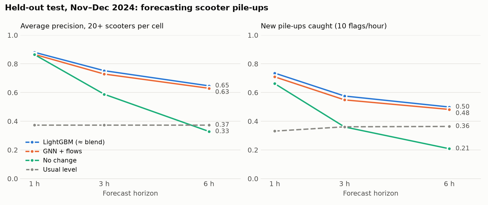
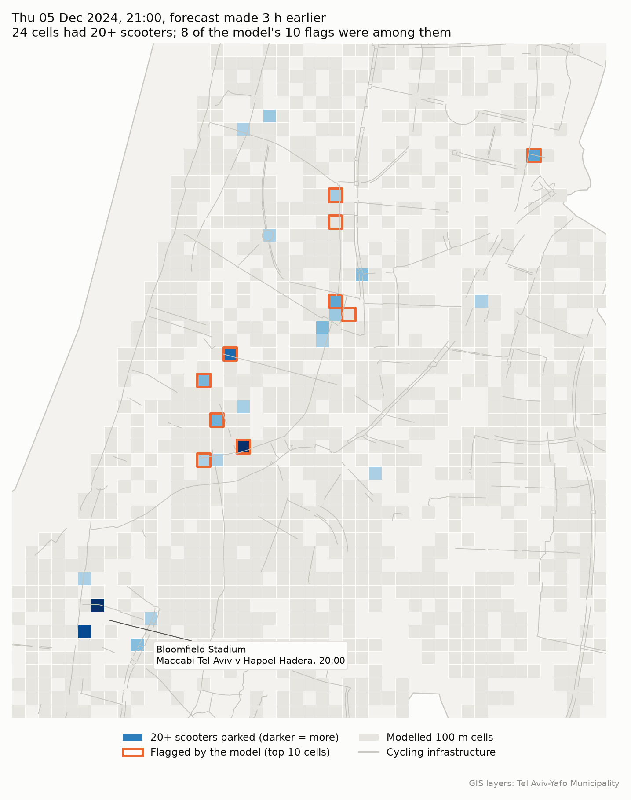

# Forecasting e-scooter pile-ups in Tel Aviv-Yafo

Shared dockless e-scooters tend to collect on the same pavements, where they block pedestrians and
annoy residents. This project forecasts **where and when scooters will pile up, 1 to 6 hours ahead**,
on a 100 m grid over Tel Aviv-Yafo. With that lead time, a city or an operator can send rebalancing
crews or enforcement before a pavement is blocked, instead of after.

It uses a full year of 2024 vehicle-status data and compares a gradient-boosted model (LightGBM)
with spatio-temporal graph neural networks. All models and settings were chosen on a tuning period,
and then scored **once** on two held-out months (Nov–Dec 2024).



## Results on the held-out test (Nov–Dec 2024)

A *pile-up* is a 100 m cell with **20 or more** scooters parked at the same time. The forecasts
are scored as a ranking of cells, using average precision (AP), which suits rare events. A second
measure is the share of *new* pile-ups (cells below 20 when the forecast is made) that are among
the 10 cells flagged each hour.

| Model | AP 20+, 1 h | AP 20+, 3 h | AP 20+, 6 h | New pile-ups caught, 3 h | MAE, 3 h |
|---|---|---|---|---|---|
| **Blend** (0.6 LightGBM + 0.4 GNN) | **0.884** | **0.755** | **0.650** | **57.6%** | **0.715** |
| LightGBM | 0.881 | 0.752 | 0.646 | 57.6% | 0.718 |
| GNN + scooter flows (3 seeds) | 0.866 | 0.729 | 0.630 | 54.9% | 0.750 |
| No change (current count) | 0.865 | 0.588 | 0.329 | 36.0% | 0.755 |
| Usual level (cell × weekday × hour) | 0.373 | 0.373 | 0.373 | 36.1% | 1.296 |
| Same hour last week | 0.385 | 0.385 | 0.385 | 35.0% | 1.433 |

**What this shows**

- **The learned models matter more the further ahead you look.** At 1 hour, the current count is
  almost as good as any model. At 6 hours, the models' average precision is about twice that of
  the current count. They also catch about half of the *new* pile-ups, against about a fifth for
  the current count.
- **LightGBM is hard to beat.** The best graph neural network (cells linked to their neighbours
  and to the cells that send them scooters) came within 0.02 AP of LightGBM but never passed it.
  Blending the two adds at most 0.004. The two models mostly find the same new pile-ups: at
  3 hours, 49% are caught by both, 9% by LightGBM only, 6% by the GNN only, and 37% by neither.
- **Event crowds are the blind spot.** The models know public holidays but not events. Before opening the
  test period, I listed 19 known events (football matches, concerts, protests, missile-alert
  dates). Around football matches at Bloomfield Stadium, the blend flagged 6 of the 45 pile-up
  cell-hours 3 hours ahead, and none at the two biggest matches. The map below shows one of those matches. The event samples are small
  (a few dozen cell-hours), so this is a direction for further work, not a firm measurement.
- **Missile-alert days did not break the models.** On those dates the share of pile-ups caught was
  about the same as on ordinary days (0.65 against 0.59 for LightGBM, 3 hours ahead).



*Thursday 5 December 2024, 21:00. Eight of the model's ten flags, issued at 18:00, were among the
24 cells with 20+ scooters. The darkest cells, by Bloomfield Stadium during a football match,
were missed.*

Full tables are in [`results/`](results/): test metrics for every model, horizon and level,
results by situation and by event, the tuning-period comparison, the frozen choices, and the
data-cleaning funnel.

## Data

| Source | What | Published here? |
|---|---|---|
| **Tel Aviv-Yafo Municipality**, which receives it from the scooter operators | 2024 vehicle status changes (MDS *Status Changes*: available, reserved, on trip, removed…) with location and time | **No.** Operator data, shared for research. |
| Tel Aviv-Yafo Municipality GIS department | City boundary, traffic zones, cycling infrastructure, docking stations | Yes, in [`data/layers/`](data/layers/) with attribution. Not covered by the MIT licence. |
| [Open-Meteo](https://open-meteo.com/) archive (CC BY 4.0) | Hourly temperature, rain, wind, humidity | Downloaded by `scripts/fetch_weather.py` |
| News reports and fixture lists | The test-period event list | [`data/external/events_2024_nov_dec.csv`](data/external/events_2024_nov_dec.csv), with sources |

Without the status data the pipeline cannot be re-run, but every step is in the code and every
result is in `results/`.

## Method

```
status changes (12 monthly archives)
  └─ partition by vehicle ──► parking events ──► hourly 100 m panel ──► features ──► models
                              (11.5 M → 8.8 M)    (5,149 cells × 8,784 h)            (LightGBM, GRU, GNN)
```

1. **Parking events.** A vehicle's status records are joined into the spans it stood ready to
   ride at one spot. The rules come from my thesis pipeline
   ([sdes-cycling-infrastructure](https://github.com/ofer-geo/sdes-cycling-infrastructure)).
   Every cleaning step is counted, and 11.5 M candidate events come down to 8.8 M parking events
   ([funnel](results/parking_events_funnel.csv)). The year does not fit in a laptop's memory, so
   the archives are streamed and split into 64 vehicle partitions that can each be processed
   alone.
2. **Panel.** Each hour, the parked vehicles, arrivals, departures and operator drop-offs are
   counted in every 100 m cell (EPSG:2039). There are 2,016 modelled cells: those that reached 5
   scooters during training, minus 13 depot-like cells where operators stage vehicles.
3. **No look-ahead.** A forecast made at hour *t* for *t + h* uses only data up to *t*,
   including the weather. Only the calendar of the target hour (hour, weekday, holiday) is known
   in advance.
4. **Models.**
   - *Baselines:* no change, same hour last week, and the cell's usual level for that weekday and
     hour.
   - *LightGBM:* one Poisson model for all horizons, using lags, recent flows, the usual level,
     neighbouring cells, the weather and features of the cell itself.
   - *GRU:* a shared recurrent encoder of each cell's last 24 hours.
   - *GNN:* the same encoder, plus message passing between touching cells. The *GNN + flows*
     variant also passes messages along a scooter-flow graph built from consecutive parking
     events of the same vehicle, which links distant cells that rides connect.
5. **Honest evaluation.** The data is split into training (29 Jan – 31 Aug), tuning (Sep–Oct)
   and test (1 Nov – 28 Dec). Every choice was made on the tuning period by mean AP 20+ at 3 and
   6 hours: model variants, GNN seeds, the blend weight and the flagging cutoffs. The choices
   were frozen in [`results/choices.json`](results/choices.json), and the event list was locked
   before the test period was opened. `scripts/final_test.py` then ran once.

## Reproducing

```bash
python -m venv .venv && .venv/Scripts/activate      # or source .venv/bin/activate
pip install -e ".[dev,nn,figures]"
pytest                                              # 36 tests, synthetic data only

# with the status archives in "raw data/<YYYY-MM>.rar":
python scripts/partition_status.py
python scripts/build_events.py
python scripts/fetch_weather.py
PY=python bash scripts/run_tuning_round.sh          # panel, flow graph, benchmarks, neural variants
python scripts/train_nn.py --model gnn_flow --seed 43     # extra seeds
python scripts/train_nn.py --model gnn_flow --seed 44
python scripts/save_predictions.py --split tune --neural gnn_flow_w0_seed42 gnn_flow_w0_seed43 gnn_flow_w0_seed44
python scripts/select_final.py --gnn gnn_flow_w0_seed42 gnn_flow_w0_seed43 gnn_flow_w0_seed44
python scripts/save_predictions.py --split test --neural gnn_flow_w0_seed42 gnn_flow_w0_seed43 gnn_flow_w0_seed44
python scripts/final_test.py
python scripts/make_figures.py
```

All settings are in [`config/default.yaml`](config/default.yaml).

## Repository layout

```
config/          settings: paths, cleaning rules, grid, splits, horizons
src/oversupply/  library: archive streaming, parking events, panel, features, flow graph,
                 models, metrics
scripts/         pipeline steps, run in the order under Reproducing
tests/           unit tests on synthetic data
data/layers/     municipal GIS layers (attribution in its README)
data/external/   test-period event list
results/         final metrics and frozen choices
docs/figures/    figures in this README
```

## Licence

Code: [MIT](LICENSE). The GIS layers in `data/layers/` belong to the Tel Aviv-Yafo Municipality
(see [its README](data/layers/README.md)). Weather data: Open-Meteo, CC BY 4.0.

Author: **Ofer Shahal**, [portfolio](https://ofer-geo.github.io/personal_portfolio/).
